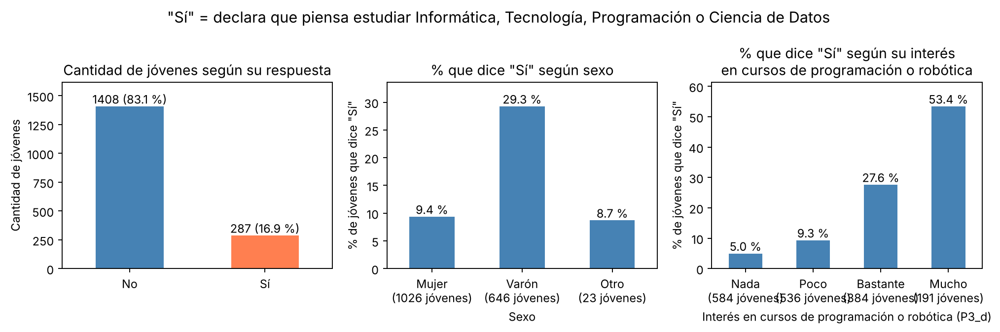
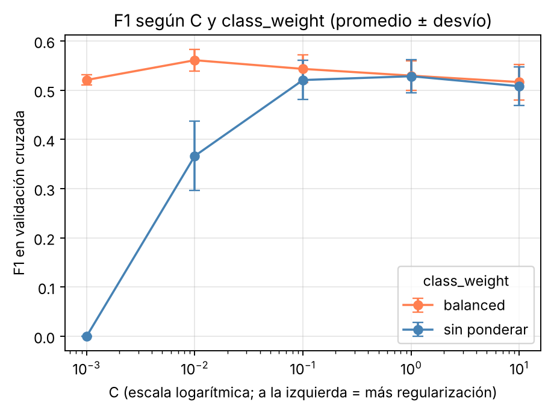
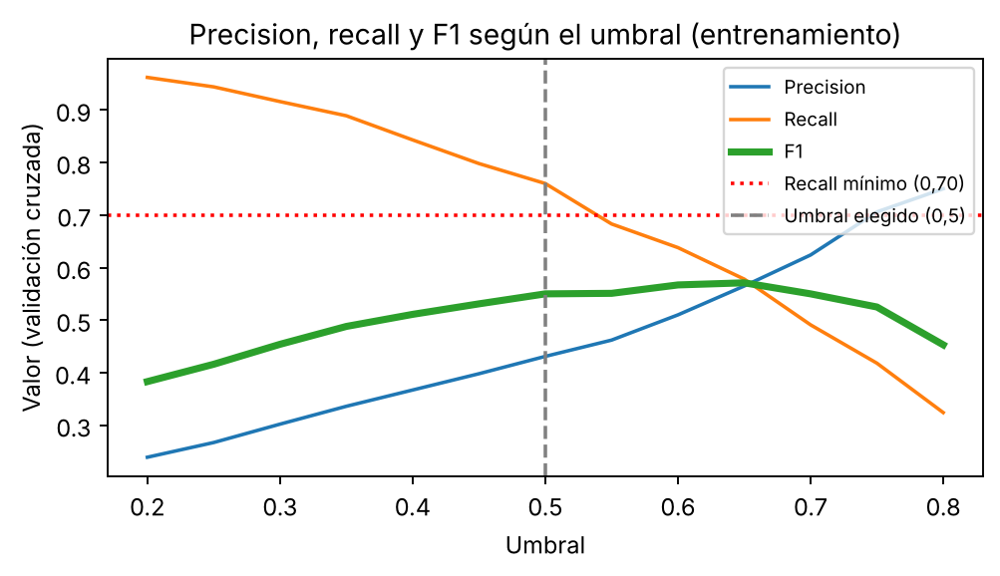
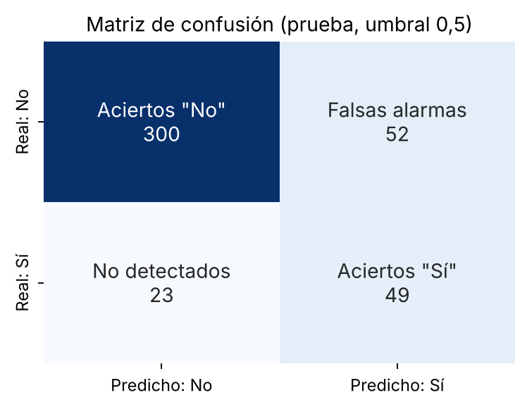
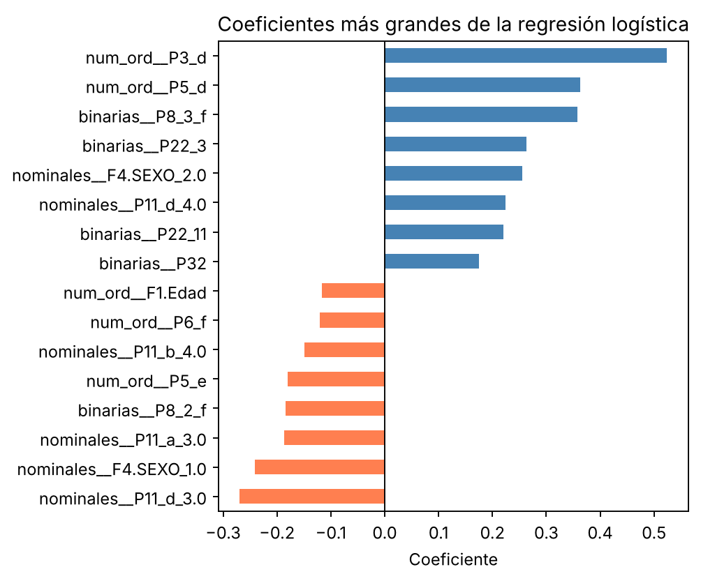

# Informe final – Predicción del interés en Informática, Tecnología, Programación o Ciencia de Datos

Mauricio Guillermo Turdo · Tecnicatura Superior en Ciencia de Datos e IA · Politécnico Malvinas Argentinas · Noviembre de 2026

Materia: Aprendizaje Automático · Profesor: Nicolás Caballero

**Índice**

1. Introducción y objetivo
2. Origen de los datos
3. Población, objetivo y preparación
4. Exploración
5. Modelo
6. Resultados
7. Variables que más pesan
8. Conclusiones
9. Limitaciones y ética
10. Repositorio y reproducibilidad
11. Referencias
12. Anexo. Variable objetivo y variables de entrada

## 1. Introducción y objetivo

Conocer qué jóvenes se interesan por estudiar Informática, Tecnología, Programación o Ciencia de Datos sirve para decidir dónde invertir recursos y qué acciones hacer para acercar a más jóvenes a estas áreas.

Los datos vienen de una encuesta del MINCyT sobre la actitud de los jóvenes hacia las profesiones STEM (ciencia, tecnología, ingeniería y matemática). Dentro de ese marco, el trabajo se concentra en un caso puntual: los jóvenes de 16 a 18 años que piensan seguir estudiando y si declaran que quieren estudiar Informática, Tecnología, Programación o Ciencia de Datos. En la encuesta el interés no es parejo: declara interés el 29,3 % de los varones y el 9,4 % de las mujeres, y esa diferencia es una de las cosas que el trabajo tiene en cuenta.

**Objetivo general:** construir un modelo de regresión logística que prediga si un joven de 16 a 18 años declara que piensa estudiar alguna de esas áreas, e identificar qué respuestas se asocian con ese interés.

**Objetivos específicos:**

1. Preparar los datos de la encuesta y definir la variable objetivo.
2. Explorar los datos y ver cómo se reparte el interés.
3. Entrenar el modelo y elegir sus hiperparámetros y el umbral con validación cruzada.
4. Evaluarlo en jóvenes que no vio, comparándolo con un modelo de referencia y con el modelo por defecto.
5. Identificar las variables que más se asocian con el interés.

### Tipo de problema

Es un problema de **clasificación binaria supervisada**: el modelo aprende de jóvenes con la respuesta conocida ("Sí" o "No" al interés) para predecir la de otros que no vio. Se resolvió con **regresión logística**, que calcula la probabilidad de "Sí" y permite ver qué respuestas pesan más. Se eligió porque es un modelo simple y fácil de interpretar: sus coeficientes muestran qué respuestas suben o bajan la probabilidad de interés, y maneja bien las variables categóricas una vez convertidas con One-Hot.

## 2. Origen de los datos

| Campo | Detalle |
|---|---|
| Fuente | Encuesta "Actitud de los jóvenes hacia las profesiones STEM", consorcio IDES-KNAC para el MINCyT |
| Descarga | Portal argentina.gob.ar: [microdatos (CSV)](https://www.argentina.gob.ar/sites/default/files/estudio_stem_usuaria.csv) · [libro de variables](https://www.argentina.gob.ar/sites/default/files/libro_de_variables_usuaria-_stem.xlsx) · [informe preliminar](https://www.argentina.gob.ar/sites/default/files/informe_preliminar_jovenes_stem.pdf). Descargados el 3 de octubre de 2026. |
| Período | 17 de julio al 19 de agosto de 2023 |
| Muestra | Encuesta online, no probabilística, por cuotas por región: los resultados valen para esta muestra, no para todos los jóvenes del país |
| Tamaño | 2.891 filas y 217 columnas (la ficha técnica indica 2.880; la diferencia no está explicada en la documentación) |
| Licencia | Uso público con reconocimiento de autoría y comunicación previa por escrito |

## 3. Población, objetivo y preparación de los datos

- **Población:** de los 2.891 encuestados, 2.386 respondieron que piensan seguir estudiando al terminar la escuela ("Sí, pienso seguir estudiando" o "Sí, ya arranqué un terciario o una carrera universitaria"), cursen o no el secundario (83 % asiste, 4,3 % dejó por un tiempo y 12,7 % lo terminó). Se excluyeron 267 que respondieron "No sé aún" cuando se les preguntó qué piensan estudiar, para simplificar el trabajo, y quedan **2.119**. Los resultados no se pueden generalizar a los indecisos. El recorte no es neutro: entre los 505 que no piensan seguir estudiando o no saben todavía hay más varones (61,8 % frente a 37,7 %).
- **Variable objetivo (`y`):** `y = 1` si el joven marcó la opción "Pensás seguir estudiando Informática / Tecnología / Programación / Ciencia de Datos" y `y = 0` si no, lo que no significa que la rechace. Es la intención declarada, no la carrera que estudiará. Hay 359 "Sí" (16,9 %) y 1.760 "No".
- **Variables excluidas (101 columnas):** el identificador y el ponderador; las preguntas de filtro y las demás opciones de qué estudiar; las preguntas sobre los motivos de elegir o no una carrera científica o tecnológica y de no seguir estudiando, que dependen de la respuesta (por ejemplo, los motivos de elegir Informática los responden todos los "Sí" y ningún "No"); si tiene hijos y cuántos; y dos preguntas poco claras sobre los integrantes del hogar de 18 años o más. Se descartaron además "último año cursado del secundario" y "si la persona que conoce en ciencia o tecnología es de su familia" por tener muchos vacíos.
- **Códigos especiales y vacíos:** "no tengo la materia" (Informática, Biología y Física / Química) y "No sé" (nivel educativo del principal sostén del hogar y de la madre) se pasan a 11 indicadores 0/1. En el tipo de relación con la persona que conoce en ciencia o tecnología y en el año que cursa, el vacío significa "no corresponde". En habitaciones para dormir, los 5 valores de 15 o más, imposibles, pasan a vacío.
- **Partición:** 80/20 estratificada (`random_state=42`): 1.695 para entrenamiento y 424 para prueba. La imputación, el escalado y el One-Hot están dentro del `Pipeline` y se ajustan solo con el entrenamiento (125 columnas pasan a 208).

### Dimensiones del conjunto de trabajo

| Conjunto | Jóvenes | "Sí" | % de "Sí" |
|---|---|---|---|
| Encuesta completa | 2.891 | — | — |
| Piensan seguir estudiando | 2.386 | — | — |
| Sin los indecisos (población de trabajo) | 2.119 | 359 | 16,9 % |
| Entrenamiento (80 %) | 1.695 | 287 | 16,9 % |
| Prueba (20 %) | 424 | 72 | 17,0 % |

### Preprocesamiento

| Paso | Qué se hizo |
|---|---|
| 1 | Se filtró la población y se excluyeron los 267 indecisos. |
| 2 | Se quitaron 101 columnas (identificador, ponderador, preguntas de filtro y preguntas que dependen de la respuesta). |
| 3 | Las variables de sí / no se pasaron a 1 (Sí) y 0 (No). |
| 4 | Se crearon 11 indicadores para "no tengo la materia" y "No sé". |
| 5 | En habitaciones para dormir, los 5 valores de 15 o más, imposibles, pasaron a vacío. |
| 6 | Se dividió en entrenamiento y prueba (80/20, estratificada, `random_state=42`). |
| 7 | Dentro del Pipeline, solo con el entrenamiento: imputación de faltantes, estandarización y One-Hot (125 columnas pasan a 208). |

**Variables de entrada (125):** 114 respuestas de la encuesta más 11 indicadores creados.

| Tema | Qué se pregunta | Códigos en la base |
|---|---|---|
| Datos personales y del hogar | Edad, sexo, región, país de nacimiento, internet y computadora en casa, integrantes del hogar, habitaciones para dormir, parentesco con el principal sostén del hogar, nivel educativo del principal sostén y de la madre | `F1.Edad`, `F4.SEXO`, `REGION`, `P28`, `P31`, `P32`, `P33a`, `P38`, `P35`, `P36`, `P37` |
| Escuela | Si asiste, tipo de escuela, si es técnica, año y orientación que cursa | `P4`, `P23`, `P26`, `P24`, `P27` |
| Uso del tiempo | Tiempo dedicado a trabajar, ayudar en casa, estudiar, leer, hacer deporte, salir con amigos y jugar en red | `P2_a` a `P2_g` |
| Interés en ciencia y tecnología | Ver contenidos, buscar información, ir a museos o ferias, hacer cursos de programación o robótica | `P3_a` a `P3_d` |
| Materias (Lengua, Matemática, Sociales, Informática, Biología, Física / Química) | Cuánto gustan, cómo valora la educación recibida y cómo le fue según sus notas | `P5`, `P6`, `P7` |
| Cómo describe las materias (Matemática; Biología, Física y Química; Computación, Informática y Tecnología) | Fácil, difícil, interesante, útil para resolver problemas, aburrida, útil para el futuro laboral | `P8` |
| Cómo describe a los docentes de esas materias | Saben mucho, explican bien, promueven el trabajo en grupo, enseñan con juegos o experimentos, usan videos | `P9` |
| Recursos usados en clase | Biblioteca, laboratorio, computadora, internet, charlas con expertos, apps, excursiones | `P10` |
| Actividades en las que participó | Talleres de robótica / programación, tutorías para olimpíadas (matemática, ciencias, informática), ferias o concursos | `P11` |
| Personas que trabajan en ciencia y tecnología | Si conoce a alguien, qué relación tiene y cómo describe a esas personas (curiosa, creativa, con buen sueldo, rara, etc.) | `P19`, `P20`, `P22` |
| Indicadores creados | "No tengo la materia" y "No sé" | `no_tiene_*`, `no_sabe_*` |

## 4. Exploración de los datos

- **Desbalance:** solo el 16,9 % de los jóvenes de entrenamiento dice "Sí".
- **Sexo:** declara interés el 29,3 % de los varones y el 9,4 % de las mujeres.
- **Interés en hacer cursos de programación o robótica:** el porcentaje de "Sí" sube de 5,0 % (sin interés) a 53,4 % (mucho interés).
- **Correlación con el objetivo:** interés en cursos de programación o robótica 0,39, que guste la materia Informática 0,32 y ser mujer −0,25.

*Figura 1. Datos de entrenamiento: clases, sexo e interés en cursos de programación o robótica (`P3_d`).*

**Conclusiones del EDA:** el interés previo en programación y el sexo son las diferencias más marcadas. Como hay desbalance, la exactitud sola no alcanza y se usan también precisión, recall, F1 y ROC-AUC. Una correlación alta no prueba fuga: el interés en cursos de programación o robótica, la orientación del colegio y la participación en talleres y tutorías miden interés o experiencia previa que se conoce antes de elegir carrera, así que se conservan, aunque están muy cerca del objetivo.

### Revisión de variables cercanas al objetivo

Se revisó que ninguna variable repita la respuesta que se quiere predecir. Se separaron las actitudes y preferencias generales de las preguntas que se acercan más a la misma elección:

| Variable | Qué expresa | Grupo |
|---|---|---|
| Interés en hacer cursos de programación o robótica (`P3_d`) | Interés en una actividad de informática | Cercana |
| Que guste la materia Informática / computación (`P5_d`) | Gusto por una materia | Cercana |
| Considerar que Computación / Informática / Tecnología "me sirve para mi futuro laboral" (`P8_3_f`) | Opinión sobre la materia | Cercana |
| Haber participado o querer participar en talleres de robótica / programación (`P11_a`) y en tutorías para olimpíadas de informática (`P11_d`) | Experiencia o intención de participar | Cercana |
| Uso del tiempo, gusto, valoración y notas de las demás materias, cómo describe las materias y a los docentes, recursos usados en clase, cómo describe a las personas de ciencia y tecnología, datos personales y del hogar | Actitudes generales y contexto | General |

Ninguna de las cercanas es la misma pregunta que el objetivo: expresan interés o experiencia previa, no la elección de qué estudiar. Las preguntas que sí expresan esa elección ya estaban fuera: las demás opciones de qué estudiar y los motivos de elegir o no una carrera, que se responden según lo que el joven marcó. Ninguna variable reproduce sola la respuesta: la que mejor separa (`P3_d`) tiene un ROC-AUC de 0,77 en el entrenamiento.

**Prueba de sensibilidad:** se quitaron las cinco variables cercanas y se volvió a entrenar con los mismos hiperparámetros y el umbral 0,50. En la prueba el modelo da precisión 0,40, recall 0,64, F1 0,49 y ROC-AUC 0,79 (con todas las variables: 0,49, 0,68, 0,57 y 0,85). Pierde capacidad, pero sigue ordenando mucho mejor que el azar, así que no depende solo de esas variables.

## 5. Modelo

- **Algoritmo:** regresión logística (scikit-learn). Calcula una probabilidad de "Sí" y predice "Sí" si supera un umbral.
- **Arquitectura:** un `Pipeline` que une la preparación y el modelo: imputación de faltantes (mediana, constante 0 o categoría más frecuente, según el tipo de variable), estandarización y One-Hot, y regresión logística.
- **Hiperparámetros:** se buscaron con `GridSearchCV` (validación cruzada de 5 particiones, métrica F1) sobre 10 combinaciones: `C` = 0,001 / 0,01 / 0,1 / 1 / 10 (regularización) y `class_weight` = `None` o `'balanced'`. Los demás quedaron por defecto (`max_iter` = 1000).
- **Elegido:** `C = 0,01` con `class_weight='balanced'` (F1 de validación 0,561, desvío 0,022).
  - Se comparó con F1 porque la exactitud favorecería a "siempre No" (83 %) y el recall solo a "siempre Sí".
  - Hay unos 5 "No" por cada "Sí". Sin ponderar, con `C` chico el modelo casi siempre responde "No" (F1 de 0 y 0,37); con `balanced` el F1 nunca baja de 0,52.
  - `C = 0,01` da el mayor F1. La ventaja sobre `C = 0,1` es de 0,02, parecida al desvío.
- **Umbral de decisión:** 0,50. Se eligió con validación cruzada sobre el entrenamiento como el de mayor precisión entre los que tienen recall de al menos 0,70 (recall 0,76). Se priorizó el recall porque, para decidir recursos y acciones, dejar pasar a un joven interesado cuesta más que una falsa alarma. El de mayor F1 es 0,65 (F1 0,571), pero deja pasar más interesados.

*Figura 2. F1 promedio de la validación cruzada para cada valor de `C`, con y sin ponderar las clases.*

Con ponderación de clases el F1 se mantiene entre 0,52 y 0,56 y es máximo con C = 0,01. Sin ponderar, con C chico el modelo casi siempre responde "No" y el F1 cae a 0 y 0,37.

*Figura 3. Precisión, recall y F1 según el umbral, con probabilidades de validación cruzada sobre el entrenamiento.*

Al subir el umbral la precisión sube y el recall baja. Con 0,50 el recall de validación es 0,76; con 0,55 baja a 0,68 y deja de cumplir el mínimo de 0,70. Por eso 0,50 es el umbral elegido.

## 6. Resultados

Evaluación en la prueba (424 jóvenes: 72 "Sí" y 352 "No"):

| Modelo | Exactitud | Precisión | Recall | F1 |
|---|---|---|---|---|
| Referencia (siempre "No") | 0,830 | — | 0,000 | — |
| Por defecto (`C = 1`, sin ponderar) | 0,858 | 0,630 | 0,403 | 0,492 |
| **Elegido, umbral 0,50** | 0,823 | 0,485 | 0,681 | 0,566 |
| Elegido, umbral 0,65 | 0,866 | 0,623 | 0,528 | 0,571 |

*Figura 4. Matriz de confusión del modelo elegido en la prueba (umbral 0,50).*

- **Interpretación:** con umbral 0,50 el modelo detecta 49 de los 72 interesados y hace 52 falsas alarmas (precisión 0,49: casi la mitad de sus "Sí" son falsas alarmas). El ROC-AUC es 0,85: ante un joven con "Sí" y otro con "No", le asigna más probabilidad al "Sí" en 85 de cada 100 casos (0,5 sería azar).
- **Frente al modelo por defecto:** detecta casi 7 de cada 10 interesados en lugar de 4 de cada 10, y mejora el F1 y el ROC-AUC (0,826 a 0,853). Pierde exactitud porque hace más falsas alarmas.
- **Umbral:** con 0,50 se detectan 11 interesados más que con 0,65 (49 frente a 38), a cambio de 29 falsas alarmas más (52 frente a 23).
- **Aclaración:** en el entrenamiento el umbral 0,50 dio un recall de 0,76 y en la prueba dio 0,68, algo por debajo del 0,70 pedido. Son jóvenes distintos y la prueba tiene solo 72 interesados, así que el recall varía bastante entre grupos. El umbral no se reajustó con la prueba.

## 7. Variables que más pesan

La figura 5 muestra las 8 variables que más aumentan y las 8 que más reducen la probabilidad. Estas son las principales (el número es el peso dentro del modelo, no un porcentaje):

| Variable | Código | Peso |
|---|---|---|
| Interés en hacer cursos de programación o robótica | `P3_d` | +0,52 |
| Que guste la materia Informática / computación | `P5_d` | +0,36 |
| Considerar que Computación / Informática / Tecnología "me sirve para mi futuro laboral" | `P8_3_f` | +0,36 |
| Describir a quien trabaja en ciencia o tecnología como "con un buen sueldo" | `P22_3` | +0,26 |
| Ser varón | `F4.SEXO` | +0,25 |
| No haber participado ni querer hacerlo en tutorías para olimpíadas de informática | `P11_d_3` | −0,27 |
| Ser mujer | `F4.SEXO` | −0,24 |
| No haber participado ni querer hacerlo en talleres de robótica / programación | `P11_a_3` | −0,19 |
| Considerar que Biología / Física / Química "me sirve para mi futuro laboral" | `P8_2_f` | −0,18 |
| Que guste la materia Biología | `P5_e` | −0,18 |

- **Son asociaciones, no causas.** Lo que más pesa es el interés previo en informática.
- **Cercanía con el objetivo:** varias de las más importantes miden interés o experiencia en informática, muy cerca de lo que se predice. Se conocen antes de elegir carrera, así que no son fuga, pero parte de la capacidad del modelo viene de ahí.
- **Sexo:** aparece porque la diferencia ya estaba en los datos (29,3 % de los varones frente a 9,4 % de las mujeres).

*Figura 5. Variables que más aumentan (azul) y más reducen (naranja) la probabilidad de interés.*

## 8. Conclusiones

La regresión logística permite detectar a casi 7 de cada 10 jóvenes interesados, pero con muchas falsas alarmas. Sirve como un primer filtro para ordenar a los jóvenes por probabilidad de interés y decidir dónde orientar recursos, no para decidir sobre una persona. No predice qué carrera estudiará un joven, solo su intención declarada, y no se aplica a los indecisos.

**Trabajo futuro:** comparar con otros algoritmos (árbol de decisión, Random Forest), evaluar con validación cruzada completa y definir con quien use el modelo cuántas falsas alarmas se pueden aceptar.

### Aporte del trabajo

El trabajo arma un modelo simple y explicable con datos de encuesta: elige los hiperparámetros y el umbral con validación cruzada y lo evalúa en jóvenes que no vio, frente a un modelo de referencia y al modelo por defecto. Además muestra qué respuestas se asocian con el interés en informática, lo que puede servir de punto de partida para pensar acciones con jóvenes.

## 9. Limitaciones y consideraciones éticas

- Muestra online y no probabilística; quedan afuera los indecisos y quienes no piensan seguir estudiando.
- Predictores y objetivo se respondieron al mismo tiempo: no se sabe si lo declarado coincide con lo que después estudian.
- Pocos "Sí" en la prueba (72) y una sola partición 80/20: las métricas pueden variar con otra división.
- Se usan microdatos anonimizados, con reconocimiento de autoría al consorcio IDES-KNAC y fines académicos.
- El sexo es una variable del modelo. Refleja una diferencia que ya hay en los datos; por eso se propone usarlo solo como apoyo para analizar grupos, nunca para decidir sobre una persona.

## 10. Repositorio y reproducibilidad

El repositorio sigue la estructura Cookiecutter Data Science: `data/raw` (CSV original), `data/interim` y `data/processed` (archivos del EDA), `notebooks/` (`01_EDA.ipynb` y `02_Modelado_regresion_logistica.ipynb`), `models/` (modelo entrenado), `docs/` (informe y libro de variables) y `reports/figures/`. Para reproducir: instalar `requirements.txt`, ejecutar el EDA y luego el Modelado, con rutas relativas desde `notebooks/`.

## 11. Referencias

- IDES-KNAC / MINCyT (2023). Encuesta "Actitud de los jóvenes hacia las profesiones STEM". [Microdatos (CSV)](https://www.argentina.gob.ar/sites/default/files/estudio_stem_usuaria.csv) y [libro de variables](https://www.argentina.gob.ar/sites/default/files/libro_de_variables_usuaria-_stem.xlsx). Portal argentina.gob.ar.
- IDES-KNAC / MINCyT (2024). [Actitud de los jóvenes hacia las profesiones STEM. Informe preliminar](https://www.argentina.gob.ar/sites/default/files/informe_preliminar_jovenes_stem.pdf).
- Pedregosa et al. (2011). Scikit-learn: Machine Learning in Python. Journal of Machine Learning Research, 12, 2825–2830.

## Anexo. Variable objetivo y variables de entrada

**Variable objetivo (`y`):** declara que piensa estudiar Informática, Tecnología, Programación o Ciencia de Datos (opción "Pensás seguir estudiando Informática / Tecnología / Programación / Ciencia de Datos", código `P13_9`). `y = 1` si la marcó y `y = 0` si no.

Las 125 variables de entrada, en el orden de la encuesta, con el tipo que se usó en el preprocesamiento. Los 11 indicadores son variables creadas para marcar "no tiene la materia" y "no sabe".

| # | Variable | Código | Tipo |
|---|---|---|---|
| 1 | Edad | `F1.Edad` | Numérica |
| 2 | Región | `REGION` | Categórica |
| 3 | Sexo | `F4.SEXO` | Categórica |
| 4 | Tiempo dedicado a: trabajar | `P2_a` | Ordinal |
| 5 | Tiempo dedicado a: ayudar con alguna tarea de la casa / cuidado de algún familiar | `P2_b` | Ordinal |
| 6 | Tiempo dedicado a: estudiar / hacer tarea | `P2_c` | Ordinal |
| 7 | Tiempo dedicado a: leer cosas que te interesan (comics, novelas, historietas) | `P2_d` | Ordinal |
| 8 | Tiempo dedicado a: deporte / entrenamiento / gimnasio | `P2_e` | Ordinal |
| 9 | Tiempo dedicado a: salir con amigos/as | `P2_f` | Ordinal |
| 10 | Tiempo dedicado a: jugar en red | `P2_g` | Ordinal |
| 11 | Interés en: mirar, escuchar o leer contenidos sobre ciencia y tecnología | `P3_a` | Ordinal |
| 12 | Interés en: buscar información en internet sobre ciencia o tecnología | `P3_b` | Ordinal |
| 13 | Interés en: ir a museos, muestras o ferias científicas y/o tecnológicas | `P3_c` | Ordinal |
| 14 | Interés en: hacer cursos de programación o robótica | `P3_d` | Ordinal |
| 15 | Situación escolar actual | `P4` | Categórica |
| 16 | Gusto por la materia Lengua / Literatura | `P5_a` | Ordinal |
| 17 | Gusto por la materia Matemática | `P5_b` | Ordinal |
| 18 | Gusto por la materia Sociales | `P5_c` | Ordinal |
| 19 | Gusto por la materia Informática / computación | `P5_d` | Ordinal |
| 20 | Gusto por la materia Biología | `P5_e` | Ordinal |
| 21 | Gusto por la materia Física / Química | `P5_f` | Ordinal |
| 22 | Valoración de la educación recibida en Lengua / Literatura | `P6_a` | Ordinal |
| 23 | Valoración de la educación recibida en Matemática | `P6_b` | Ordinal |
| 24 | Valoración de la educación recibida en Sociales | `P6_c` | Ordinal |
| 25 | Valoración de la educación recibida en Informática / computación | `P6_d` | Ordinal |
| 26 | Valoración de la educación recibida en Biología | `P6_e` | Ordinal |
| 27 | Valoración de la educación recibida en Física / Química | `P6_f` | Ordinal |
| 28 | Notas en Lengua / Literatura | `P7_a` | Ordinal |
| 29 | Notas en Matemática | `P7_b` | Ordinal |
| 30 | Notas en Sociales | `P7_c` | Ordinal |
| 31 | Notas en Informática / computación | `P7_d` | Ordinal |
| 32 | Notas en Biología | `P7_e` | Ordinal |
| 33 | Notas en Física / Química | `P7_f` | Ordinal |
| 34 | Matemática: "Es fácil para mi" | `P8_1_a` | Sí / no |
| 35 | Matemática: "Es difícil para mi" | `P8_1_b` | Sí / no |
| 36 | Matemática: "Es interesante para mi" | `P8_1_c` | Sí / no |
| 37 | Matemática: "Me ayuda a resolver problemas cotidianos" | `P8_1_d` | Sí / no |
| 38 | Matemática: "Es aburrida para mí" | `P8_1_e` | Sí / no |
| 39 | Matemática: "Me sirve para mi futuro laboral" | `P8_1_f` | Sí / no |
| 40 | Matemática: "Ninguna" | `P8_1_g` | Sí / no |
| 41 | Biología / Física / Química: "Es fácil para mi" | `P8_2_a` | Sí / no |
| 42 | Biología / Física / Química: "Es difícil para mi" | `P8_2_b` | Sí / no |
| 43 | Biología / Física / Química: "Es interesante para mi" | `P8_2_c` | Sí / no |
| 44 | Biología / Física / Química: "Me ayuda a resolver problemas cotidianos" | `P8_2_d` | Sí / no |
| 45 | Biología / Física / Química: "Es aburrida para mí" | `P8_2_e` | Sí / no |
| 46 | Biología / Física / Química: "Me sirve para mi futuro laboral" | `P8_2_f` | Sí / no |
| 47 | Biología / Física / Química: "Ninguna" | `P8_2_g` | Sí / no |
| 48 | Computación / Informática / Tecnología: "Es fácil para mi" | `P8_3_a` | Sí / no |
| 49 | Computación / Informática / Tecnología: "Es difícil para mi" | `P8_3_b` | Sí / no |
| 50 | Computación / Informática / Tecnología: "Es interesante para mi" | `P8_3_c` | Sí / no |
| 51 | Computación / Informática / Tecnología: "Me ayuda a resolver problemas cotidianos" | `P8_3_d` | Sí / no |
| 52 | Computación / Informática / Tecnología: "Es aburrida para mí" | `P8_3_e` | Sí / no |
| 53 | Computación / Informática / Tecnología: "Me sirve para mi futuro laboral" | `P8_3_f` | Sí / no |
| 54 | Computación / Informática / Tecnología: "Ninguna" | `P8_3_g` | Sí / no |
| 55 | Computación / Informática / Tecnología: "No tengo/tuve estas materias" | `P8_3_h` | Sí / no |
| 56 | Docentes de Matemática: "Saben/Sabían mucho sobre la materia" | `P9_1_a` | Sí / no |
| 57 | Docentes de Matemática: "Explican/Explicaban bien la materia" | `P9_1_b` | Sí / no |
| 58 | Docentes de Matemática: "Promueven/Promovían la participación y el trabajo en grupo" | `P9_1_c` | Sí / no |
| 59 | Docentes de Matemática: "Enseñan/Enseñaban a través de juegos, experimentos o proyecto" | `P9_1_d` | Sí / no |
| 60 | Docentes de Matemática: "Traen/Traían videos, notas y películas para trabajar en clase" | `P9_1_e` | Sí / no |
| 61 | Docentes de Matemática: "Ninguna" | `P9_1_f` | Sí / no |
| 62 | Docentes de Biología / Física / Química: "Saben/Sabían mucho sobre la materia" | `P9_2_a` | Sí / no |
| 63 | Docentes de Biología / Física / Química: "Explican/Explicaban bien la materia" | `P9_2_b` | Sí / no |
| 64 | Docentes de Biología / Física / Química: "Promueven/Promovían la participación y el trabajo en grupo" | `P9_2_c` | Sí / no |
| 65 | Docentes de Biología / Física / Química: "Enseñan/Enseñaban a través de juegos, experimentos o proyecto" | `P9_2_d` | Sí / no |
| 66 | Docentes de Biología / Física / Química: "Traen/Traían videos, notas y películas para trabajar en clase" | `P9_2_e` | Sí / no |
| 67 | Docentes de Biología / Física / Química: "Ninguna" | `P9_2_f` | Sí / no |
| 68 | Docentes de Computación / Informática / Tecnología: "Saben/Sabían mucho sobre la materia" | `P9_3_a` | Sí / no |
| 69 | Docentes de Computación / Informática / Tecnología: "Explican/Explicaban bien la materia" | `P9_3_b` | Sí / no |
| 70 | Docentes de Computación / Informática / Tecnología: "Promueven/Promovían la participación y el trabajo en grupo" | `P9_3_c` | Sí / no |
| 71 | Docentes de Computación / Informática / Tecnología: "Enseñan/Enseñaban a través de juegos, experimentos o proyecto" | `P9_3_d` | Sí / no |
| 72 | Docentes de Computación / Informática / Tecnología: "Traen/Traían videos, notas y películas para trabajar en clase" | `P9_3_e` | Sí / no |
| 73 | Docentes de Computación / Informática / Tecnología: "Ninguna" | `P9_3_f` | Sí / no |
| 74 | Docentes de Computación / Informática / Tecnología: "No tengo/tuve estas materias" | `P9_3_g` | Sí / no |
| 75 | Uso en clase de: biblioteca (Matemática, Biología, Física y Química) | `P10_a` | Categórica |
| 76 | Uso en clase de: laboratorio / taller (Matemática, Biología, Física y Química) | `P10_b` | Categórica |
| 77 | Uso en clase de: uso de computadora para la clase (Matemática, Biología, Física y Química) | `P10_c` | Categórica |
| 78 | Uso en clase de: uso de internet para la clase (Matemática, Biología, Física y Química) | `P10_d` | Categórica |
| 79 | Uso en clase de: charlas con expertos/as en temas de ciencia y tecnología (Matemática, Biología, Física y Química) | `P10_e` | Categórica |
| 80 | Uso en clase de: apps o programas específicos para trabajar en clase (Matemática, Biología, Física y Química) | `P10_f` | Categórica |
| 81 | Uso en clase de: excursiones/ visitas a lugar relacionados con ciencia o tecnología (Matemática, Biología, Física y Química) | `P10_g` | Categórica |
| 82 | Participación en: talleres de robótica / programación | `P11_a` | Categórica |
| 83 | Participación en: tutorías para olimpiadas de matemática | `P11_b` | Categórica |
| 84 | Participación en: tutorías para olimpiadas de biología, física, química | `P11_c` | Categórica |
| 85 | Participación en: tutorías para olimpíadas de informática | `P11_d` | Categórica |
| 86 | Participación en: ferias / concursos de ciencias o tecnología | `P11_e` | Categórica |
| 87 | Conoce a alguien que trabaja en ciencia o tecnología | `P19` | Sí / no |
| 88 | Género de la persona que conoce en ciencia o tecnología | `P20` | Categórica |
| 89 | Persona de ciencia o tecnología descrita como "Solitaria" | `P22_1` | Sí / no |
| 90 | Persona de ciencia o tecnología descrita como "Nerd" | `P22_2` | Sí / no |
| 91 | Persona de ciencia o tecnología descrita como "Con un buen sueldo" | `P22_3` | Sí / no |
| 92 | Persona de ciencia o tecnología descrita como "Rara" | `P22_4` | Sí / no |
| 93 | Persona de ciencia o tecnología descrita como "Antisocial" | `P22_5` | Sí / no |
| 94 | Persona de ciencia o tecnología descrita como "Curiosa" | `P22_6` | Sí / no |
| 95 | Persona de ciencia o tecnología descrita como "Viajera" | `P22_7` | Sí / no |
| 96 | Persona de ciencia o tecnología descrita como "Distraída" | `P22_8` | Sí / no |
| 97 | Persona de ciencia o tecnología descrita como "Apasionada" | `P22_9` | Sí / no |
| 98 | Persona de ciencia o tecnología descrita como "Que le gusta trabajar en grupo" | `P22_10` | Sí / no |
| 99 | Persona de ciencia o tecnología descrita como "Creativa" | `P22_11` | Sí / no |
| 100 | Persona de ciencia o tecnología descrita como "Inquieta" | `P22_12` | Sí / no |
| 101 | Persona de ciencia o tecnología descrita como "Más inteligente que lo habitual" | `P22_13` | Sí / no |
| 102 | Persona de ciencia o tecnología descrita como "Otra" | `P22_14` | Sí / no |
| 103 | Tipo de escuela (pública o privada) | `P23` | Sí / no |
| 104 | Año que cursa del secundario | `P24` | Categórica |
| 105 | Escuela técnica | `P26` | Sí / no |
| 106 | Orientación que cursa | `P27` | Categórica |
| 107 | País de nacimiento | `P28` | Categórica |
| 108 | Internet en casa | `P31` | Sí / no |
| 109 | Computadora en casa | `P32` | Sí / no |
| 110 | Cantidad de integrantes del hogar | `P33a` | Numérica |
| 111 | Parentesco con el principal sostén del hogar | `P35` | Categórica |
| 112 | Nivel educativo del principal sostén del hogar | `P36` | Ordinal |
| 113 | Nivel educativo de su mamá | `P37` | Ordinal |
| 114 | Habitaciones para dormir en la casa | `P38` | Numérica |
| 115 | Indicador: no tiene la materia Informática / computación (pregunta de gusto por la materia) | `no_tiene_P5_d` | Indicador (sí/no) |
| 116 | Indicador: no tiene la materia Biología (pregunta de gusto por la materia) | `no_tiene_P5_e` | Indicador (sí/no) |
| 117 | Indicador: no tiene la materia Física / Química (pregunta de gusto por la materia) | `no_tiene_P5_f` | Indicador (sí/no) |
| 118 | Indicador: no tiene la materia Informática / computación (pregunta de valoración de la educación recibida) | `no_tiene_P6_d` | Indicador (sí/no) |
| 119 | Indicador: no tiene la materia Biología (pregunta de valoración de la educación recibida) | `no_tiene_P6_e` | Indicador (sí/no) |
| 120 | Indicador: no tiene la materia Física / Química (pregunta de valoración de la educación recibida) | `no_tiene_P6_f` | Indicador (sí/no) |
| 121 | Indicador: no tiene la materia Informática / computación (pregunta de notas) | `no_tiene_P7_d` | Indicador (sí/no) |
| 122 | Indicador: no tiene la materia Biología (pregunta de notas) | `no_tiene_P7_e` | Indicador (sí/no) |
| 123 | Indicador: no tiene la materia Física / Química (pregunta de notas) | `no_tiene_P7_f` | Indicador (sí/no) |
| 124 | Indicador: no sabe el nivel educativo del principal sostén del hogar | `no_sabe_P36` | Indicador (sí/no) |
| 125 | Indicador: no sabe el nivel educativo de su mamá | `no_sabe_P37` | Indicador (sí/no) |
